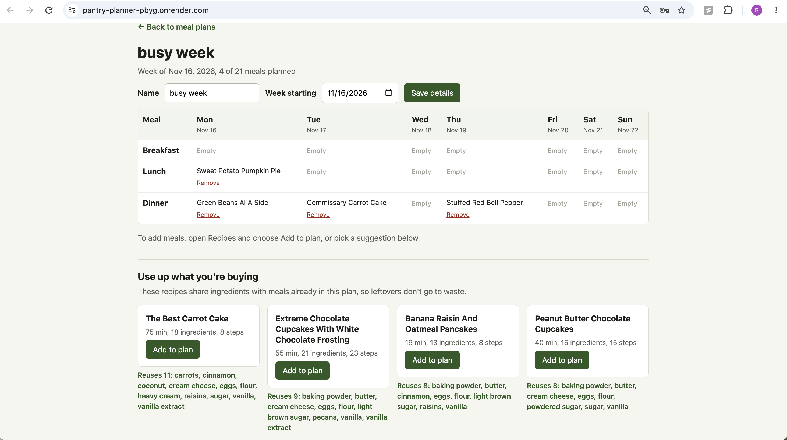

# Pantry Planner

Plan meals from what you already have, use up what you buy, and make grocery
lists for only what you still need.

**Live app:** https://pantry-planner-pbyg.onrender.com

The app runs on Render's free tier, so the first load after a while can take
up to a minute while the server wakes up.



## Authors

- Rajvi Desai
- Jharshini Vejaya Kumar

## Class

CS5610 Web Development, Northeastern University, Fall 2026 

Instructor: John Alexis Guerra Gómez

## Objective

Most recipe sites start from what you want to eat. Pantry Planner starts from
what you already have, so food gets used before it goes bad.

- **Planning (Rajvi):** create an account, browse and filter 8,000 recipes,
  plan meals on a weekly grid, and get suggestions for recipes that reuse
  ingredients the week already needs.
- **Pantry (Jharshini):** keep a pantry with use-by dates, find recipes you
  can make from it, and make grocery lists that skip what you already have.

## Features

| Feature | What it does |
|---|---|
| Accounts | Register and log in with a username and password (Passport, local strategy, with sessions) |
| Recipe browser | Search by name and filter by diet, cooking time, steps, course, and cuisine, with pagination |
| Weekly meal planner | Assign recipes to breakfast, lunch, and dinner for each day of the week |
| Reuse suggestions | Recipes that share at least two ingredients with meals already in the plan, so leftovers get used |
| Pantry | Add, edit, and remove what you have, with optional quantities and use-by dates. Expired and use-soon items are flagged. |
| Cook from your pantry | Recipes ranked by fewest missing ingredients. Among equals, recipes that use soon-to-expire items come first. |
| Grocery lists | Made from chosen recipes, leaving out pantry items and staples. Check items off, edit them, or add your own. |

## Tech stack

- **Frontend:** React with Hooks (built with Vite), `fetch`, PropTypes
- **Backend:** Node.js + Express (ES modules)
- **Database:** MongoDB with the native Node.js driver (no Mongoose)
- **Authentication:** Passport (local strategy) with `express-session`.
  Passwords are hashed with Node's built-in `crypto.scrypt`.
- Deployed on Render, with MongoDB Atlas

In development, Vite forwards `/api` requests to Express. In production,
Express serves the built React app from the same origin, so no CORS library is
needed.

## Data

Recipes come from **Food.com Recipes and Interactions** on Kaggle:
<https://www.kaggle.com/datasets/shuyangli94/food-com-recipes-and-user-interactions>

> Shuyang Li, "Food.com Recipes and Interactions," Kaggle, 2019,
> doi: 10.34740/KAGGLE/DSV/783630. Licensed under CC BY 4.0.

The original CSV (295 MB) was converted to JSON once, outside this repo. The
committed file `data/recipes.json` holds 8,000 recipes, randomly sampled with
a fixed seed from 228,542 valid rows. Cleaning removed rows with no name or
with cooking times of 0 or over 24 hours, trimmed and lowercased ingredients,
and turned list fields into real arrays. Nutrition and contributor fields were
dropped. The seed script also adds a `stepCount` field to each recipe.

Diet tags (vegetarian, vegan, and others) are set by Food.com and aren't
verified, so the app labels them "tagged."

## Run it locally

**You need:** Node.js 22+ and MongoDB running locally.

```bash
git clone https://github.com/desairajviii/pantry-planner.git
cd pantry-planner

# Backend
cd backend
npm install
cp .env.example .env    # then set SESSION_SECRET to any long random string
npm run seed            # loads the 8,000 recipes and creates indexes
npm run dev             # starts Express on http://localhost:3000

# Frontend (in a second terminal)
cd frontend
npm install
npm run dev             # starts Vite, usually on http://localhost:5173
```

Open the Vite URL, create an account, and start planning.

### Environment variables (`backend/.env`)

| Name | Example | Purpose |
|---|---|---|
| `MONGO_URI` | `mongodb://localhost:27017` | MongoDB connection string |
| `DB_NAME` | `pantry_planner` | Database name |
| `SESSION_SECRET` | any long random string | Signs the login session cookie |
| `PORT` | `3000` | Express port (Render sets this itself) |

Never commit `.env`. On Render, set these in the dashboard.

### Scripts

| Folder | Command | What it does |
|---|---|---|
| `backend` | `npm run dev` | Starts the server and restarts it on changes |
| `backend` | `npm start` | Starts the server (used by Render) |
| `backend` | `npm run seed` | Replaces the `recipes` collection from `data/recipes.json` |
| `backend` | `npm run lint` / `npm run format` | ESLint / Prettier |
| `frontend` | `npm run dev` | Starts the Vite dev server |
| `frontend` | `npm run build` | Builds the React app into `frontend/dist` for production |
| `frontend` | `npm run lint` / `npm run format` | ESLint / Prettier |

## Project structure

```
backend/     Express server, routes, Passport, MongoDB connection, seed script
frontend/    React app: one folder per component (Component.jsx + Component.css)
data/        recipes.json, the seeded recipe data
docs/        design document, wireframes, and screenshot
```

## Known limits

- **Ingredient matching is by name.** "Chickpeas" won't match "garbanzo
  beans." Pantry matching uses substrings, so "onion" covers "yellow onions,"
  but "egg" also covers "eggplant."
- **Recipes have ingredient names but no quantities,** so grocery list
  quantities are left for you to fill in.
- **Staples** like salt, pepper, water, and oil are treated as always on hand.

## Design document

See [docs/design-doc.md](docs/design-doc.md) for the project description,
personas, user stories, and wireframes.

## Use of generative AI

We used Claude (Anthropic) as an assistant on this project.

**Rajvi:** Used Claude to plan the work and to debug the code. I reviewed and tested the suggested changes by Claude and changed it where needed.

**Jharshini:** Used Claude for planning, including work
split, timeline, and to convert the Kaggle CSV into the
JSON seed file. Also used it for debugging and for implementation guidance
when web sources weren't enough.

## License

[MIT](LICENSE)