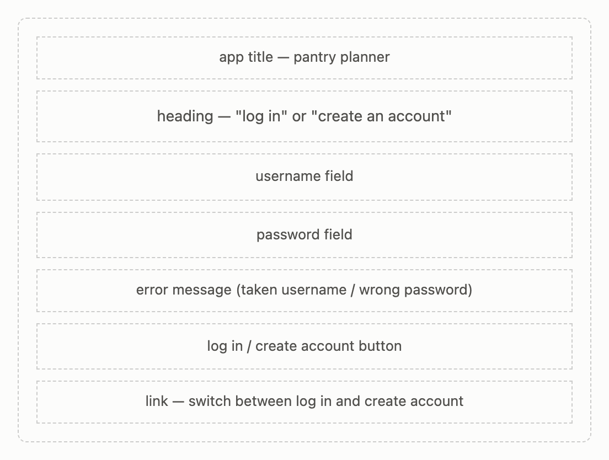
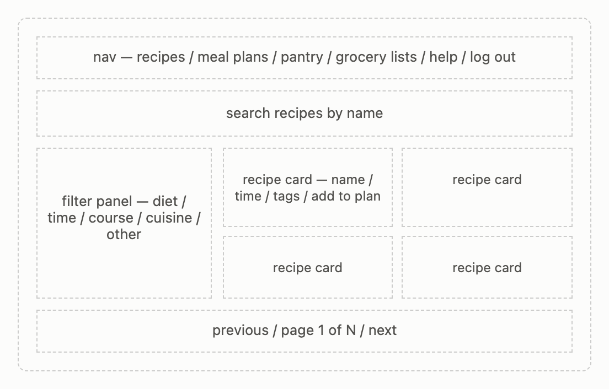
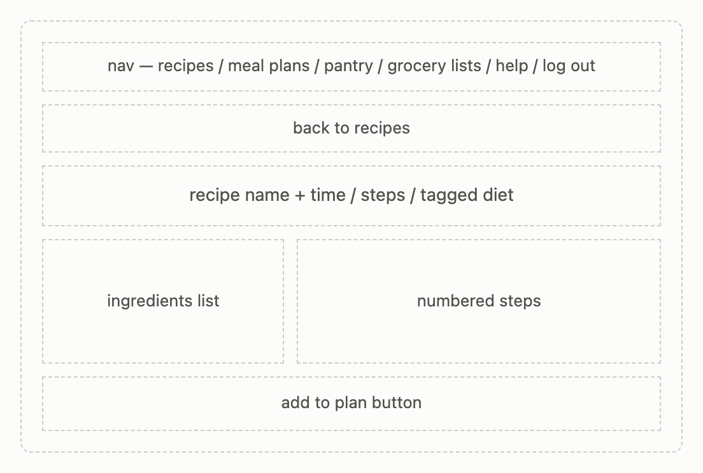
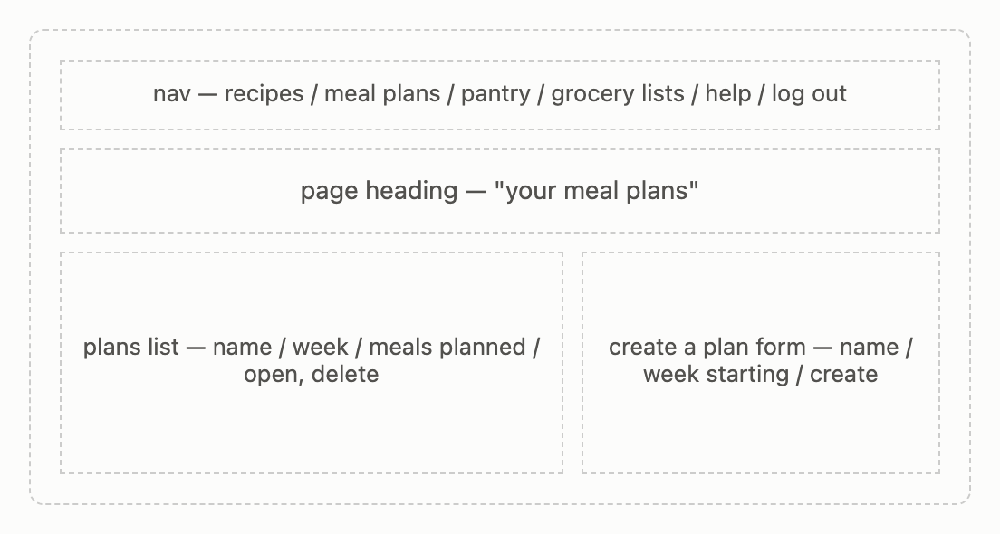
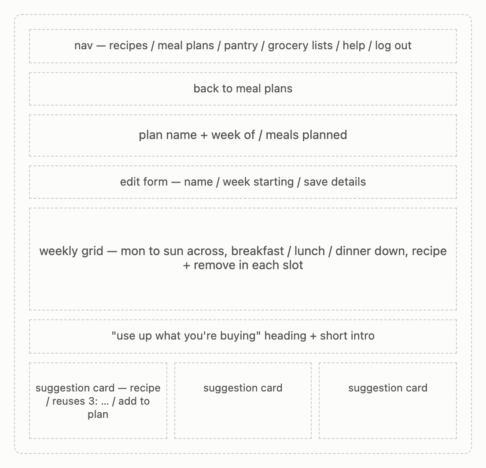
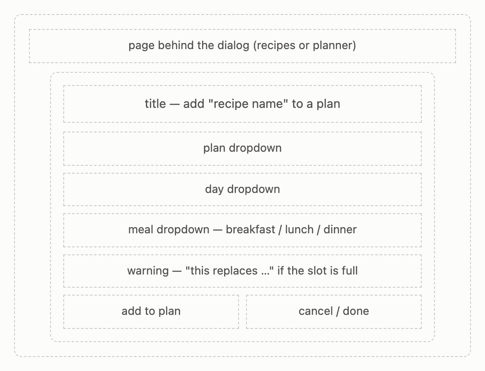
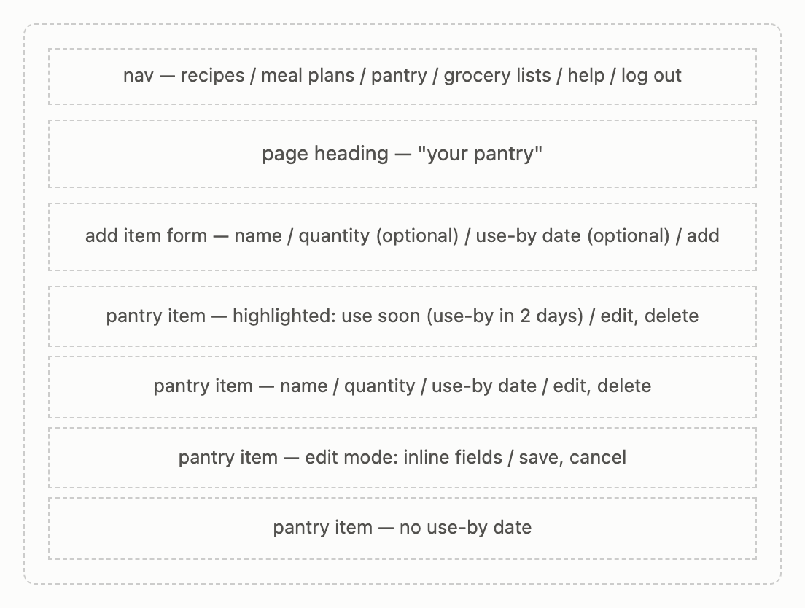
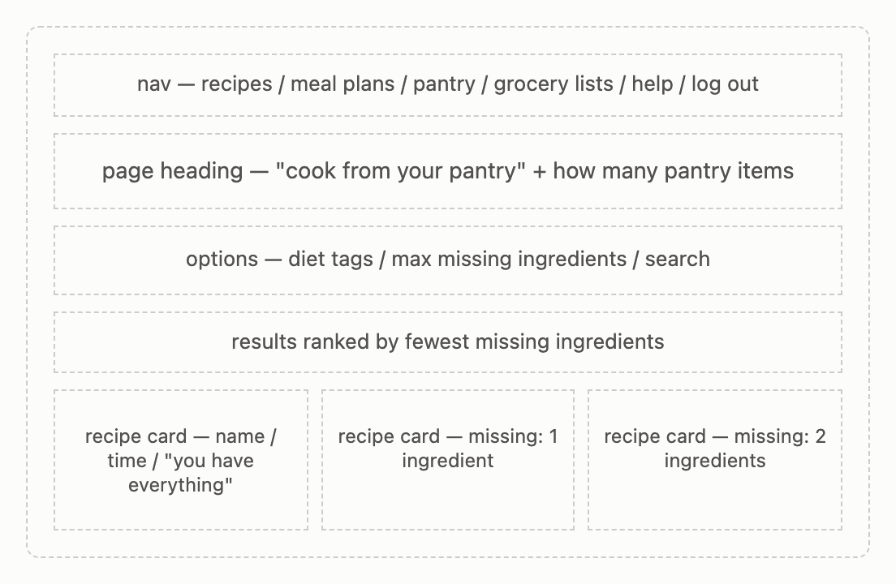
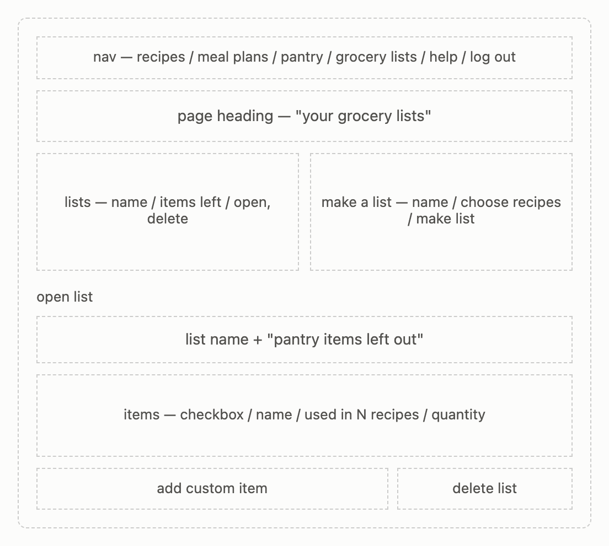
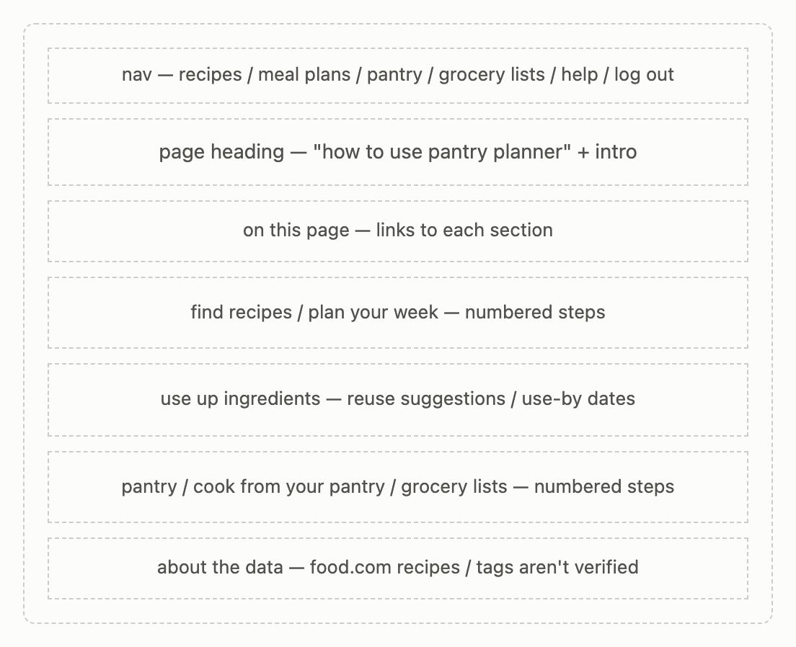

# Pantry Planner: Design Document

**Team:** Rajvi Desai, Jharshini Vejaya Kumar  
**Class:** CS5610 Web Development, Northeastern University, Fall 2026

## Project description

Pantry Planner is a meal planning site built around reducing food waste. Most
recipe sites start from what you want to eat. Pantry Planner starts from what
you already have and what you've already bought, so food gets used before it
goes bad.

Users browse recipes with filters (vegetarian, vegan, quick, easy, and more),
plan their week, and keep track of their pantry. The app then helps use up
ingredients in two ways: it suggests recipes that reuse ingredients already in
the week's plan, and it flags pantry items that are close to their use-by date.
Grocery lists skip what's already in the pantry, so users only buy what they
need.

Recipes come from the Food.com Recipes and Interactions dataset on Kaggle
(CC BY 4.0). A seed script loads 8,000 cleaned recipes into MongoDB.

The app has two main parts:

- **Planning (Rajvi):** create an account, browse and filter recipes, plan
  meals on a weekly grid, and get suggestions for recipes that reuse
  ingredients the week already needs.
- **Pantry (Jharshini):** keep a pantry with use-by dates, find recipes that
  can be made from it, and make grocery lists that skip what's already there.

Users log in with a username and password, so their plans and pantry are
saved to their account.

## User personas

### Maya, a busy grad student

Maya cooks a few times a week between classes and wants quick, simple
recipes. She often buys an ingredient for one meal, uses part of it, and
throws the rest away a week later. She also buys things she already has at
home because she forgets what's in her pantry.

**Goals:** cook quick meals without much planning; use up what she buys;
stop buying duplicates.

**Frustrations:** recipes call for half a bunch of cilantro or a quarter of a
cabbage, and the rest goes bad; she doesn't remember what's in her pantry
when she's at the store.

### Daniel, a vegetarian home cook

Daniel is vegetarian and likes planning his meals for the week on Sunday. He
wants to find vegetarian recipes quickly and fit them into a weekly plan, so
he isn't deciding what to cook every night.

**Goals:** find vegetarian recipes that fit his time; plan a full week at
once; make the most of each grocery trip.

**Frustrations:** recipe sites mix in meat dishes, so he has to filter by
hand; planning a week of meals that share ingredients takes a lot of effort.

## User stories

### Rajvi: Planning

1. **Account.** As Maya, I want to create an account and log in, so that my
   plans and pantry are saved to me.
2. **Browse recipes.** As Daniel, I want to search and filter recipes by diet,
   cooking time, course, and cuisine, so that I can quickly find meals that
   fit me.
3. **Weekly meal plan.** As Daniel, I want to create weekly meal plans by
   assigning recipes to days and meals, so that I don't have to decide what to
   cook every night.
4. **Reuse ingredients.** As Maya, I want the planner to suggest recipes that
   reuse ingredients already in my week's plan, so that leftovers get used
   instead of thrown away.

### Jharshini: Pantry

5. **Pantry.** As Maya, I want to keep a list of the ingredients in my pantry
   with their use-by dates, so that I know what I have and what to use first.
6. **Cook from the pantry.** As Maya, I want to see recipes I can make with my
   pantry, ranked by how few ingredients I'm missing, so that I use what I
   have.
7. **Grocery list.** As Maya, I want to make a grocery list from the recipes I
   plan to cook, without the items already in my pantry, so that I only buy
   what I need.

## Design mockups

The app is a single-page React app, so each mockup is a screen within it
rather than a separate HTML page. Every screen after login shares the same nav
bar: Recipes, Meal plans, Pantry, Grocery lists, Help, and Log out.

### Log in and register (`AuthForm`)

A form with a username and password, a button to log in, and a link to switch
to creating an account. Errors like a taken username or a wrong password show
above the button.

### Recipes (`RecipeBrowser`, `FilterPanel`, `RecipeCard`)

A search box and a filter panel grouped by diet, time, course, cuisine, and
other options, next to a grid of recipe cards. Each card shows the name,
cooking time, ingredient count, and diet tags (labeled "tagged," since
Food.com sets them), with an Add to plan button. Page buttons sit below the
grid.

### Recipe detail (`RecipeDetail`)

A link back to the recipes, then the recipe's name, cooking time, number of
steps, and diet tags. Below that, its ingredient list next to its numbered
steps, and an Add to plan button.

### Meal plans (`MealPlanList`)

A list of the user's plans with their week and number of meals, each with
Open and Delete buttons, next to a form to create a plan with a name and a
starting week.

### Weekly planner and reuse suggestions (`MealPlanner`, `ReuseSuggestions`)

A link back to the meal plans, the plan's name and week, and a form to edit
them. Below that, a grid with days across the top and breakfast, lunch, and
dinner down the side. Each filled slot shows the recipe and a Remove button.
Under the grid, "Use up what you're buying" lists recipes that share at least
two ingredients with meals already in the plan, showing which ingredients each
one reuses, with an Add to plan button.

### Add to plan (`AddToPlanDialog`)

A dialog over the current screen with dropdowns for the plan, day, and meal,
and Add to plan and Cancel buttons. If that slot already has a recipe, it
warns which recipe will be replaced. When opened from a plan's suggestions,
that plan is already selected.

### Pantry (`PantryManager`, `PantryItem`)

A form to add an item with a name, an optional quantity, and an optional
use-by date, above the list of pantry items. Items close to their use-by date
are highlighted with a "use soon" label so they get used first. Each item can
be edited in place or deleted.

### Cook from your pantry (`PantrySearch`)

Options to narrow the search by diet tags and by how many missing ingredients
are allowed. Results show as recipe cards ranked by fewest missing
ingredients, with each card listing what's missing, or saying the user has
everything.

### Grocery lists (`GroceryListIndex`, `GroceryListView`)

A list of the user's grocery lists, each with how many items are left, next
to a form to make a new list from chosen recipes. Opening a list shows the
items still needed (pantry items left out), each with a checkbox to mark it
as bought, how many recipes use it, and a quantity the user can fill in.
Users can add custom items or delete the list.

### How to use (`HelpPage`)

A heading and intro, links to each section, and step-by-step instructions for
finding recipes, planning a week, using up ingredients (reuse suggestions and
use-by dates), and the pantry, pantry search, and grocery lists. It ends with
notes about where the recipe data comes from and that its tags aren't
verified.